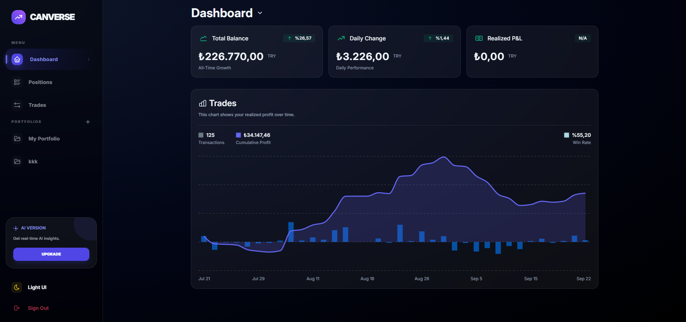

# Portfolio & Analytics Platform

A personal finance and investment tracking platform that allows users to record their trades and analyze performance
across multiple portfolios and dashboards.

## Repository layout

| Directory | Contents |
| --- | --- |
| `server/` | Spring Boot 3.5 on Java 21, Maven wrapper, backend resources, Flyway history and tests |
| `web/` | React, Vite, Mantine 9, TanStack Router and Query, and the generated OpenAPI types |
| `docs/` | Engineering guidance and screenshots |

## Local development

Use Java 21, Node.js 24 and an initialized PostgreSQL database. Set the datasource URL, username and password for your local database in the server environment. Hibernate validates the existing schema on startup. The versioned Flyway scripts build on the original database schema.

Maven automatically selects an installed JDK 21 for the backend build and Spring Boot launch, even if your shell uses another Java version. If Maven cannot find your JDK 21 installation, set `JAVA21_HOME` to its directory.

Run Spring from `server/` and Vite from `web/` in separate terminals:

```text
cd server
./mvnw spring-boot:run
```

```text
cd web
npm ci
npm run dev
```

Use `mvnw.cmd` on Windows. Vite runs at `http://localhost:5173` and uses the development API URL in `web/.env.development`. Use `web/.env.development.local` for a local override. With Spring running on port 8080, run `npm run generate:openapi` in `web/` to refresh the API types.

## Production build

Run `docker build -t borsa .` from the repository root. The image builds Vite and packages its output in the Spring jar. The container serves the frontend and API from port 8080 on the same origin. Set `SPRING_PROFILES_ACTIVE=prod` and the existing production environment variables on the deployed container.

To produce the same jar locally, run `npm run build` in `web/`, followed by `./mvnw clean package` in `server/`. Maven copies `web/dist` to the jar's static resources. Run `npm run typecheck` and `npm run check` in `web/`, and `./mvnw test` in `server/` against an initialized test database.

This project is actively evolving and focuses on real-world architecture, deployment, and scalability practices.

The platform is continuously being refactored to improve code quality,
maintainability, and user experience.

---

## 🚀 Features

- Authentication
    - Google OAuth login
    - Custom email/password login

- Trade Management
    - Buy / Sell transaction tracking
    - Support for multiple instruments (stocks, crypto, metals, etc.)
    - Support for multiple currencies
    - Multi-portfolio support

- Analytics
    - Total balance tracking
    - Daily change calculation
    - Realized P&L (monthly)
    - Cumulative and individual trade profit/loss charts
    - Performance dashboards linked to portfolios

- UI / UX (still refactoring)
    - Light / Dark mode
    - Responsive interface
    - Multiple dashboard views

- Infrastructure
    - Dockerized deployment
    - Automated builds via Dokploy
    - Environment-based configuration
    - Secure secrets management

- Market Data Integration
    - Automated data ingestion from multiple providers (Forex, BIST, upcoming crypto APIs...)
    - Dynamic adapter system for new instruments
    - Scheduled price updates
    - Generic DTO-based integration layer
    - AI-assisted data enrichment (Gemini API)

---

## 🛠️ Tech Stack

### Backend

- Java
- Spring Boot
- Spring Security
- JPA / Hibernate
- MyBatis (native queries)
- Flyway (database migrations)
- QueryDSL (selectively used, gradually refactored where native queries provide better performance and clarity)
- Domain-Driven Design (aggregate roots, rich domain models, encapsulated business logic

### Data Processing Architecture

The system includes a modular market data ingestion layer.

New data sources can be integrated by defining:

- Source URL
- DTO mapping
- Update strategy
- Schedule via market-updaters in application.yml

This allows new instruments to be added without modifying core business logic.

### Frontend (under active modernization)

- Vite + React
- TypeScript
- Mantine UI with custom styles
- TanStack Router (file-based)
- TanStack Query
- OpenAPI Fetch with generated API clients + TanStack Query integration
- Zustand
- Biome.js (code formatting and linting)

### Database

- PostgreSQL

### DevOps

- Docker
- Dokploy
- GitHub automated builds via Dokploy

---

## 📊 Project Status

This project is under active development.

The initial focus was on delivering core functionality.
As the system matured, structured database migrations and infrastructure improvements were introduced.

New features and architectural refinements are continuously being added.

### Live Demo

A live demo of the platform is available at: [https://borsa.canverse.dev](https://borsa.canverse.dev)

- Demo Account
    - Email: demo2@gmail.com
    - Password: 12345678

### Screenshots




