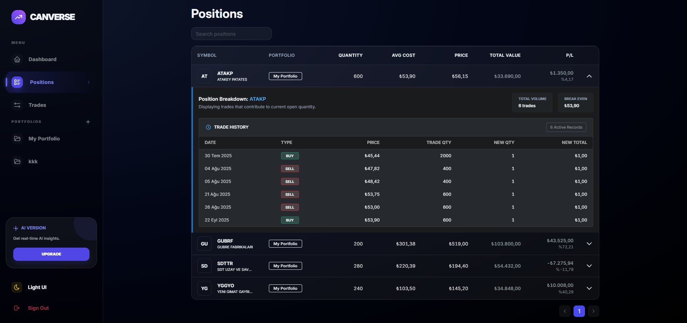
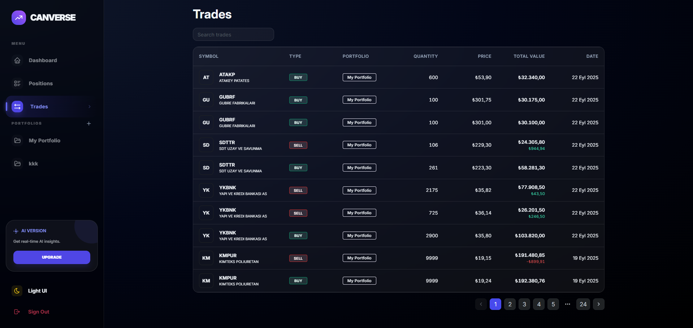
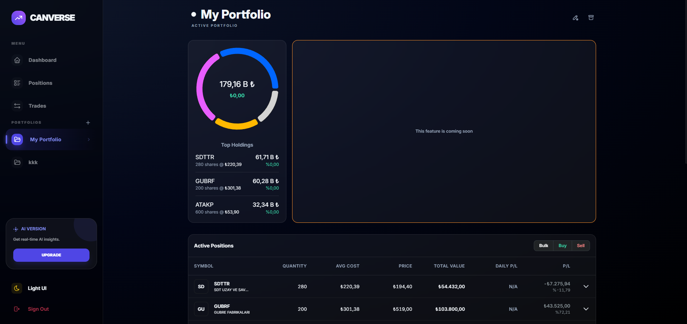

# Portfolio & Analytics Platform

A personal finance and investment tracker for recording trades, managing portfolios, and reviewing performance across currencies.

## Local development

Install JDK 21 and Node.js 24 with npm. The Maven wrapper downloads Maven on first use. If toolchain detection misses JDK 21, set `JAVA21_HOME` to its installation directory.

Use an initialized PostgreSQL database with the current application schema. Set the datasource variables below in the terminal or IDE that starts Spring.

| Variable | Value |
| --- | --- |
| `DB_URL` | PostgreSQL JDBC URL, for example `jdbc:postgresql://localhost:5432/stocks` |
| `DB_USERNAME` | Local database user |
| `DB_PASSWORD` | Local database password |

Hibernate validates the schema at startup. Flyway is disabled in the default profile, and the checked-in migrations assume an existing schema. A fresh database bootstrap procedure is pending.

On Linux, start the backend from the repository root.

```sh
cd server
./mvnw spring-boot:run
```

In Windows PowerShell, use the Windows wrapper.

```powershell
cd server
.\mvnw.cmd spring-boot:run
```

In a second terminal, start the frontend from the repository root.

```sh
cd web
npm ci
npm run dev
```

Run `npm ci` on initial setup and when the lockfile changes. Use `npm.cmd` in PowerShell if the execution policy blocks `npm.ps1`.

Spring listens on `http://localhost:8080` and Vite on `http://localhost:5173`. Use that frontend origin for local authentication because Spring's CORS configuration allows it explicitly. Vite reads the API origin from `web/.env.development`. Use the ignored `web/.env.development.local` file to override it.

### External integrations

Email and password sign-in needs only the app and database. The hosted integrations are optional for ordinary local development.

- Google sign-in uses `GOOGLE_CLIENT_ID` and `GOOGLE_CLIENT_SECRET` on the backend. The ID must match the frontend's Google OAuth provider.
- Trade document import uses `GEMINI_API_KEY`.
- The scheduled exchange-rate job uses `FOREX_RATE_API_KEY`. BIST market jobs contact public quote providers on their configured schedules. Set the Spring property `market-updater.markets.bist.enabled=false` to disable the BIST jobs locally.

Keep secrets in the server environment.

### Formatting and verification

| Task | Command |
| --- | --- |
| Apply frontend formatting | `npm run format` from `web/` |
| Check frontend formatting and lint | `npm run check` from `web/` |
| Check frontend types | `npm run typecheck` from `web/` |
| Build the frontend, including type checking | `npm run build` from `web/` |
| Apply or check Java formatting | `./mvnw spotless:apply` or `./mvnw spotless:check` from `server/` |
| Compile Java or verify the package | `./mvnw compile` or `./mvnw -DskipTests verify` from `server/` |
| Run a focused backend test | `./mvnw -Dtest=TestClass test` from `server/` |
| Run the full backend suite | `./mvnw test` with an initialized PostgreSQL test database |

In PowerShell, replace `./mvnw` with `.\mvnw.cmd`. Use the production build or the standalone TypeScript check based on what changed.

### OpenAPI

With Spring running the current backend code at `http://localhost:8080`, run `npm run generate:openapi` from `web/`. It reads `/v3/api-docs` and updates `web/src/api/schema.d.ts`. Review the generated diff and verify its consumers when an API contract changes.

### Troubleshooting

- **Spring fails to start or validate the schema** — Check the datasource variables and the first PostgreSQL, Flyway, or Hibernate error in the backend console. For migration issues, check the target database and its Flyway history before making changes.
- **API request fails** — Check the URL, status, and response in the browser Network panel. Match the response's `X-Request-Id` with the Spring console logs. Validation responses include field details.
- **Sign-in or refresh fails** — Confirm Vite is on port 5173. Check the refresh status and cookie in the Network panel. For Google sign-in, check the client configuration and the backend's authentication event.
- **Integration or query fails** — Check the corresponding backend event. Use `LOG_LEVEL=DEBUG` for application diagnostics or `SQL_LOG_LEVEL=DEBUG` to see SQL locally.

## Production builds

Cloudflare Pages serves the frontend. The repository builds it with `npm ci` and `npm run build` in `web/`, produces `web/dist`, and supplies the SPA fallback in `web/public/_redirects`. Set the browser-visible `VITE_API_BASE_URL` at build time when the API uses a separate origin.

Dokploy runs the backend image. The root [Dockerfile](Dockerfile) builds the Spring Boot jar and exposes port 8080. Build it locally with `docker build -t borsa .` from the repository root. The deployed backend uses `SPRING_PROFILES_ACTIVE=prod` and deployment-provided datasource settings and secrets.

For a local jar that also serves the frontend, build `web/` first and then run `./mvnw clean package` from `server/`. Maven copies the existing `web/dist` into the jar's static resources.

### Live Demo

A live demo of the platform is available at: [https://borsa.canverse.dev](https://borsa.canverse.dev)

- Demo Account
    - Email: demo2@gmail.com
    - Password: 12345678

### Screenshots





